<div align="center">
  

# BaPi · Aurora

**macOS 范式的 AI 原生工作台：权限先于智能，风险本人确认，提权双人复核，全程哈希链审计**

[](#验证)
[](#验证)
[](pom.xml)
[](LICENSE)

</div>

---

BaPi 是一个以**桌面（macOS 式 Dock + 窗口 + 控制中心）为入口**的 AI 原生后台系统：

- Agent 与人共用同一个执行通道，**权限不会超过操作者本人**；
- 权限内的写操作**由本人确认风险后直接执行**，只有角色变更等提权操作才需要另一位成员复核；
- 每一次调用都经过统一管线并写入**只追加的哈希链审计**，可回放、可校验；
- 能力以声明式插件扩展，数据可见范围始终跟随角色与部门。

> 决策记录见 `docs/adr/`，完整需求见 `docs/PRD.md`，接口清单见 `docs/API.md`。

## 界面速览

| | |
| --- | --- |
| 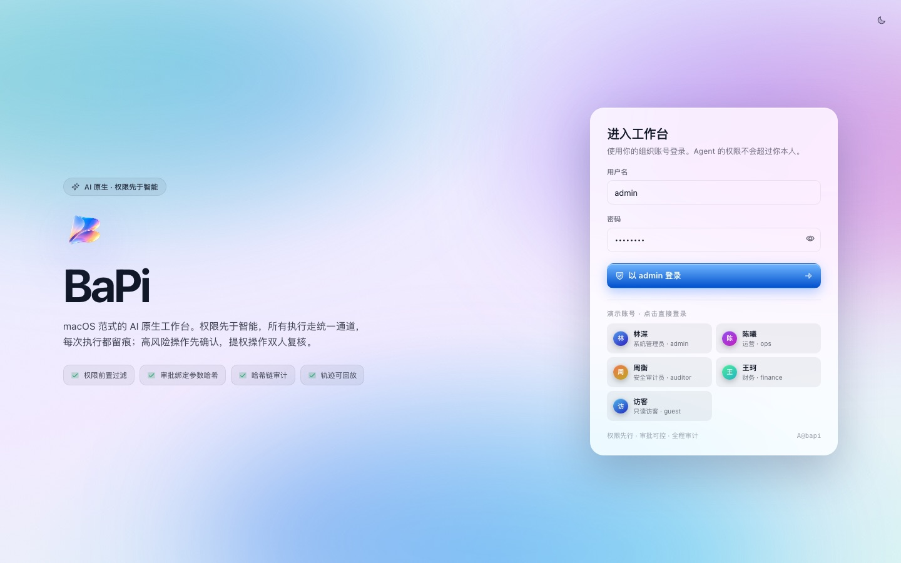 | 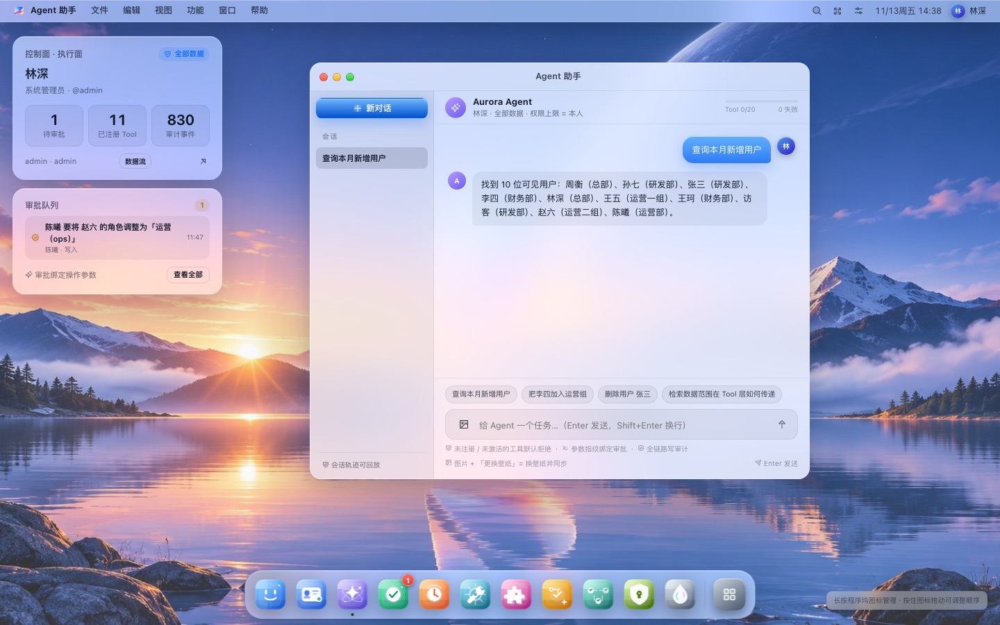 |
| **登录页** — 演示账号一键登录 | **桌面** — Dock、微件、Agent 助手 |
| 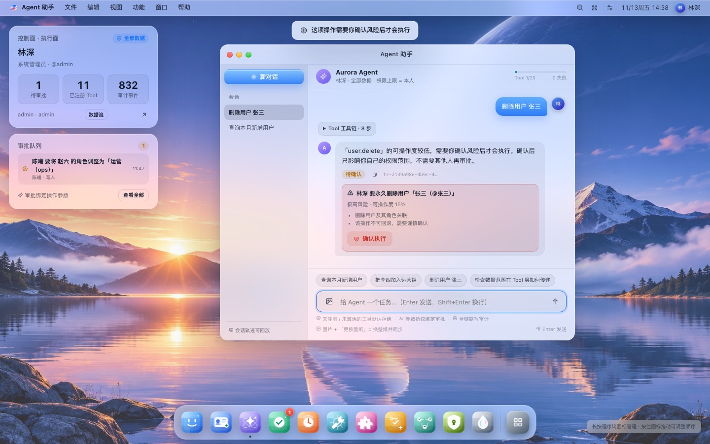 | 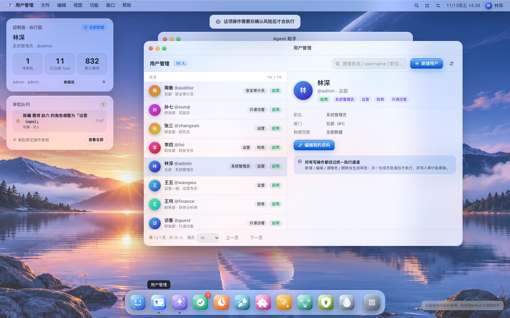 |
| **Agent 风险确认卡** — 删除前本人确认 | **用户管理** — 分页 / 编辑 / 删除 |
| 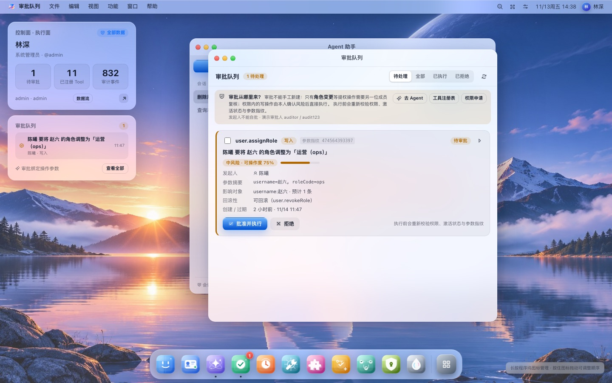 | 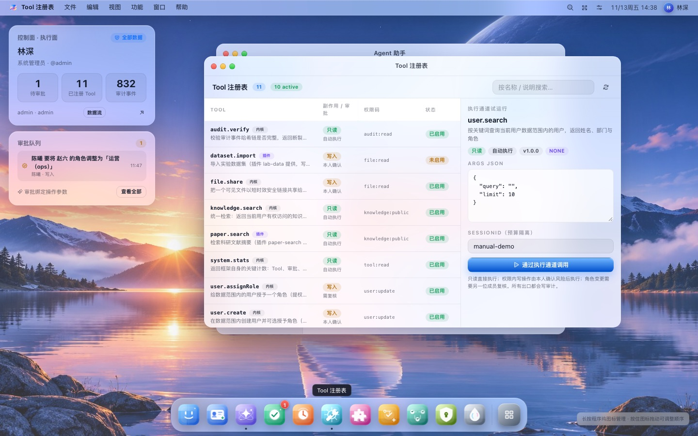 |
| **审批队列** — 仅承载提权复核 | **Tool 注册表** — 受控 Tool 一览 |
| 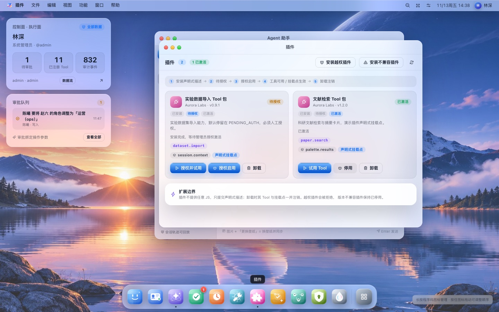 | 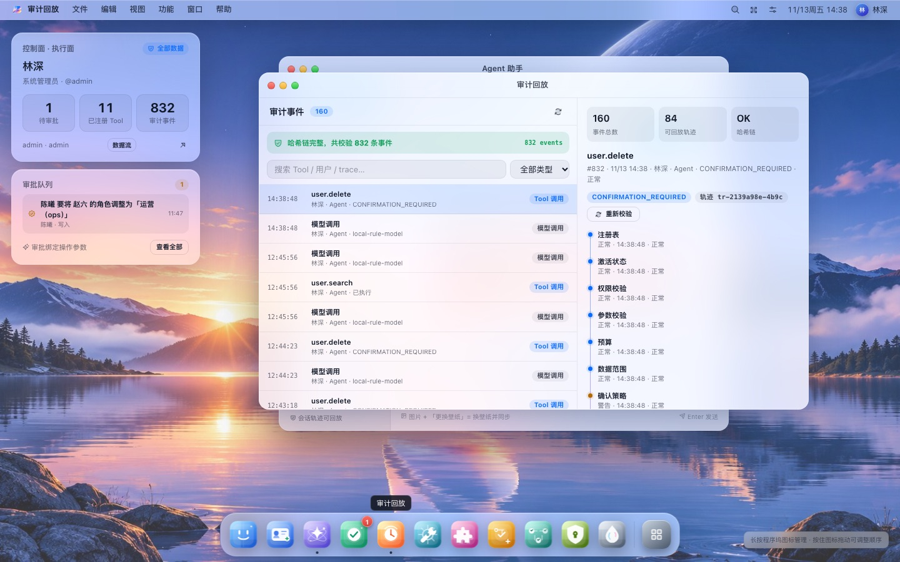 |
| **插件** — 声明式生命周期 | **审计回放** — 哈希链 + 轨迹回放 |
| 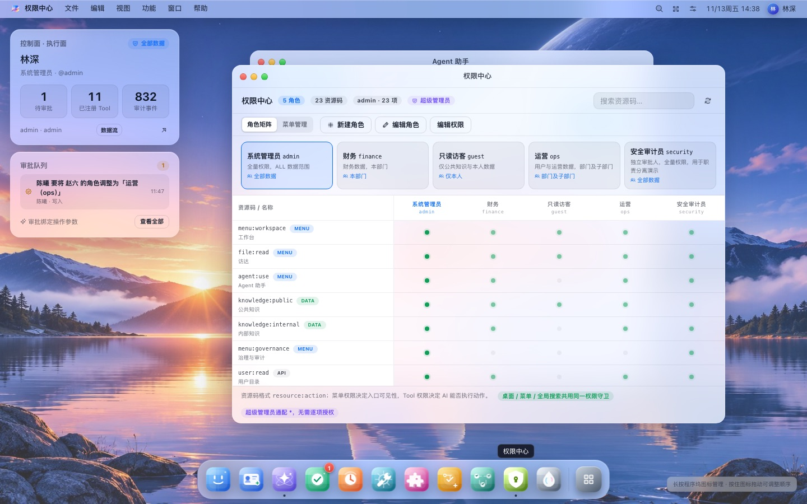 | 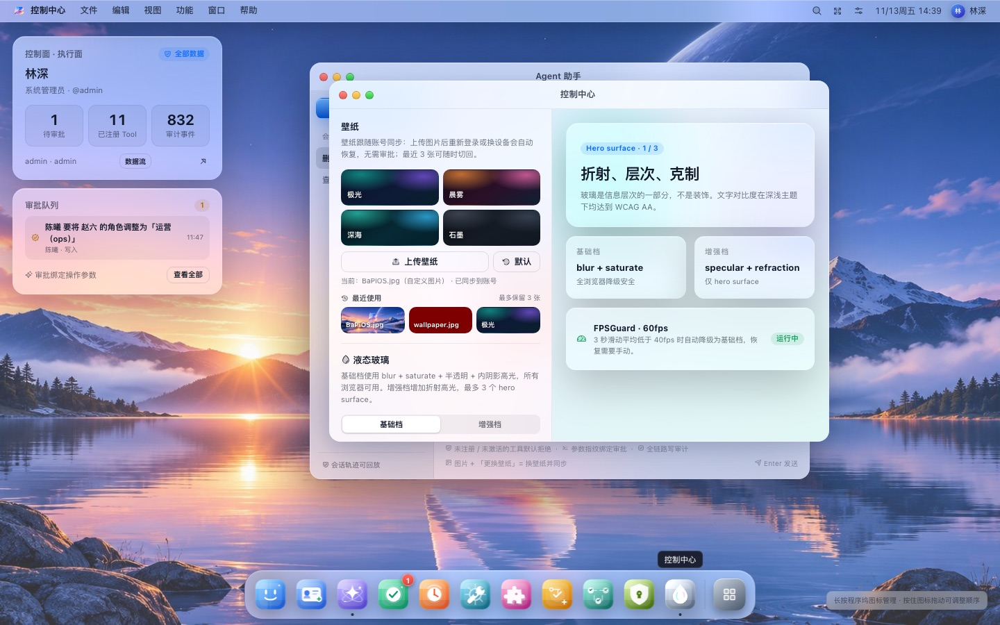 |
| **权限中心** — 角色 × 资源矩阵 | **控制中心** — 壁纸 / 玻璃 / 主题 |
| 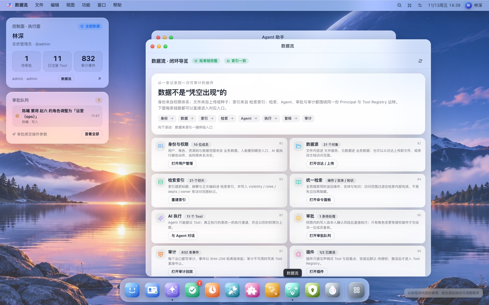 | |
| **数据流** — 入口到审计的全链路导览 | |

## 一键体验（Docker）

前置要求：Docker Desktop 或任意 Docker Engine。首次构建约 3~8 分钟。

```bash
git clone https://github.com/<you>/BaPi.git
cd BaPi
docker compose -f docker/compose.yml --profile app up -d --build
```

| 服务 | 地址 |
| --- | --- |
| Web 桌面 | http://localhost:5173 |
| API | http://localhost:8080/api/health |
| MinIO 控制台 | http://localhost:9001（aurora_minio / aurora_minio_pw） |

| 账号 | 密码 | 角色 |
| --- | --- | --- |
| `admin` | `admin123` | 超级管理员（ALL 数据范围） |
| `ops` | `ops123` | 运营负责人（部门及子部门） |
| `finance` | `finance123` | 财务分析师（本部门） |
| `guest` | `guest123` | 只读访客（仅本人） |
| `auditor` | `audit123` | 安全审计员 / 独立复核人 |

首次启动会自动执行 Flyway 迁移、注册 Tool、安装演示插件并生成演示审计轨迹，开箱即有数据可玩。

只启动中间件（本地跑后端 / 前端时用）：

```bash
docker compose -f docker/compose.yml up -d          # MySQL 3308 / pgvector 5433 / MinIO 9000
```

数据备份与恢复（MySQL + pgvector + MinIO 三份产物）：

```bash
./scripts/backup.sh                                 # 产物写入 backup/
./scripts/restore.sh backup/aurora-mysql-xxx.sql.gz backup/aurora-vector-xxx.sql.gz backup/aurora-minio-xxx.tar.gz
```

## 本地开发

```bash
./start.sh                 # 中间件 + 后端 + 前端一键启动（./start.sh stop | status）
# 等价手动方式：
docker compose -f docker/compose.yml up -d
cd aurora-app-demo && mvn spring-boot:run          # 后端 :8080
cd aurora-ui-shell && pnpm dev                     # 前端 :5173
```

## 验证

```bash
mvn -pl aurora-app-demo test                # 后端 45 个验收测试（AC-01~09、10~16、21~27 + ArchUnit）
cd aurora-ui-shell && pnpm test             # 前端单元测试 9 个
cd aurora-ui-shell && pnpm e2e              # Playwright 21 条（需 :8080 + :5173 已启动）
```

## 核心机制

- **ToolInvocationGateway 单一执行通道**：注册表 → 激活状态 → RBAC → Schema → 预算/熔断 →
  数据范围 → 风险确认 / 双人复核 → 幂等执行 → 审计。未注册 / 未激活 / 无权限一律拒绝。
- **权限内自助执行（ADR-0010）**：持有权限的操作者直接执行；可操作度 < 60% 或破坏性操作弹出
  风险确认卡；`user.assignRole` 等提权操作生成双人复核审批并绑定 `argsHash`。
- **审批状态机**：CAS 流转；执行前复验权限、激活状态、参数哈希与过期时间；发起人不能自批。
- **哈希链审计**：所有出口写 `audit_event`，SHA-256 前向链，MySQL 触发器拒绝改写，轨迹可回放。
- **检索 ACL**：可见范围过滤在向量查询时前置（over-fetch ×2），窗口期用业务库当前 ACL 二次校验。
- **声明式插件**：插件只提交描述，不提供任意 JS；越权声明被拒绝，装载后默认 `PENDING_AUTH`。
- **个性化**：壁纸（预设 / 上传）与程序坞顺序跟随账号，最近 3 张壁纸可随时切回，均无需审批。

## 技术栈

Java 17 · Spring Boot 3.5（Maven 多模块：contract / rbac-core / tool-registry / agent-runtime /
retrieval / app-demo）· React 18 + TypeScript + Vite 6 · MySQL 8 · pgvector · MinIO ·
Playwright（Chrome for Testing）。

## 目录结构

```
aurora-contract/       错误码、DTO、通用工具
aurora-rbac-core/      用户/角色/资源/数据范围（不依赖任何 AI 模块）
aurora-tool-registry/  Tool 定义、Schema 校验、审批策略
aurora-agent-runtime/  Gateway、Agent 循环、审批、审计哈希链、轨迹
aurora-retrieval/      统一检索、向量库适配（pgvector）、MinIO 存储
aurora-app-demo/       Web API、Flyway 迁移、验收测试
aurora-ui-shell/       React 桌面壳层 + E2E
docker/                compose（--profile app 一键全栈）、前后端 Dockerfile、nginx
docs/                  PRD、API、ADR、系统截图
scripts/               dev / stop / smoke / test / backup / restore
```

## 接入真实大模型

仓库默认内置**确定性本地模型**（规则式 `RuleBasedModelPort`）与**确定性本地 Embedding**，
保证演示与测试可复现、且**不需要任何 API Key**。替换点有两个，都只要提供一个 Spring
`@Primary` Bean，Gateway / 检索 / 审批 / 审计链路无需改动：

```java
// 1) 对话模型：实现 io.aurora.agent.model.ModelPort
@Component
@Primary
public class MyLlm implements ModelPort {
    private final WebClient http = WebClient.create("https://api.example.com/v1/chat");

    @Override public String provider() { return "my-llm"; }

    @Override
    public ModelTurn complete(ModelRequest request) {
        // 把 request.tools() 作为 function-calling 工具表下发；
        // 只让模型"提议" ToolCall —— 真正执行永远在 ToolInvocationGateway。
        ...
    }
}

// 2) 向量模型：实现 io.aurora.retrieval.EmbeddingPort（文本 + 图片）
```

安全约定：

- API Key 只放**环境变量或密钥管理器**（如 `AURORA_LLM_API_KEY`），启动时校验存在；
  **任何 Key 都不要提交进仓库**——当前仓库里没有任何密钥，只有演示账号的公开默认密码。
- 模型只产出"意图"（文本或 ToolCall 提议），越权 / 未注册 / 低可操作度 / 预算超限
  仍会被 Gateway 拦截，`AdversarialModelTest` 用恶意模型验证了这一点。
- 只读工具可直接自动执行；写操作会按同一套风险确认 / 双人复核策略走。

## 已知边界

- 模型为确定性本地实现，`ModelPort` / `EmbeddingPort` 是接入真实 LLM 的替换点。
- 插件动态 JAR 热加载未实现；PDF / DOCX 只按标题、摘要与文件名参与检索（未接解析器）。
- 详细边界与开放问题见 `docs/open-questions.md`。

## License

[MIT](LICENSE)
